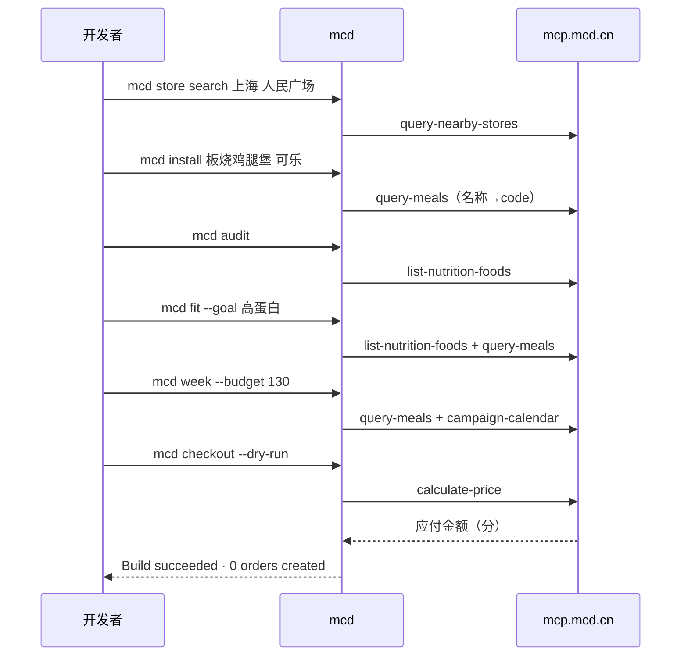

# MCP 集成说明

- **Server**：麦当劳中国 MCP，`https://mcp.mcd.cn`（Streamable HTTP），`Authorization: Bearer ${MCD_MCP_TOKEN}`（见 `mcp-config.example.json`）
- **客户端**：`mcdcli/mcp_client.py`（标准库）+ `mcdcli/backend.py`。backend 里有一份**只读白名单**，白名单之外的工具会被直接拒绝（`create-order` 等都不在白名单里，单测有覆盖）

## Tool 使用

| Tool | 命令 |
|---|---|
| `query-nearby-stores` | `mcd store search` |
| `query-meals` | `mcd menu` / `mcd install` / `mcd fit` / `mcd week` |
| `list-nutrition-foods` | `mcd nutrition` / `mcd audit` / `mcd fit` |
| `available-coupons`、`query-store-coupons` | `mcd coupon ls` / `mcd week` |
| `campaign-calendar` | `mcd cal` / `mcd week` |
| `calculate-price` | `mcd checkout --dry-run` / `mcd fit --verify` |
| `create-order` | **CLI 不调用**；只有 Skill 里的 Agent 在用户明确回复「确认下单」后才可以调用 |

## 调用流程

## 与同类项目的区别
榜上的 mcd-git 用 **git 的比喻**（add / rebase / push 下单、贡献图）。mcd-cli 走的是**包管理器 + Unix 工具**这条路：`install` 会打印依赖树，`audit` 用来查营养"漏洞"，`fit`/`week` 做目标与预算规划，`menu` 能直接接 `grep`，`cal` 看日历，`checkout` 默认就是 dry-run 构建。重点放在**营养审计、规划能力**和**零写操作**上。

## 业务价值
- 在开发者最常待的终端里触达麦当劳菜单、活动和券，适合程序员节话题传播
- `mcd audit` / `mcd fit` 用官方营养数据给出可执行的建议（换无糖饮品、按宏量营养素点餐）
- `mcd week` 帮打工人在预算内排一周不重样的午餐，配合活动日历
- dry-run 小票让用户在下单前看到真实价格，减少下单失败和取消
